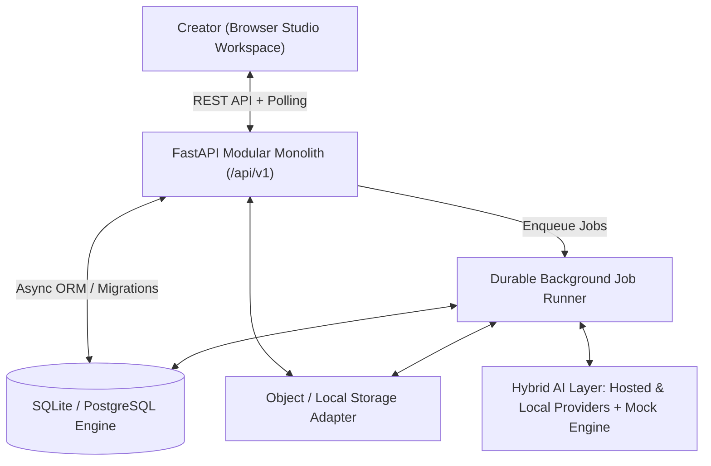
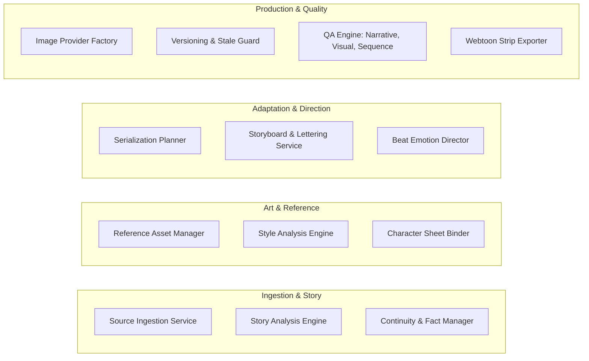

# Architecture Specification — AI Novel-to-Webtoon Studio

## 1. System Overview

The AI Novel-to-Webtoon Studio is a creator-controlled vertical serialization platform designed to adapt original literary works (novels, short stories, web novels) into high-fidelity vertical scrolling webtoons (manhwa format). The core architectural principle is **Human Creative Art Direction**: the AI systems assist with bounded creative tasks, while human creators hold explicit approval gates over story understanding, visual style profiles, episode planning, storyboarding, and final asset approval.

---

## 2. Core Architectural Separation

To prevent unintended stylistic or narrative drift, the system enforces strict isolation between eight independent versioned entities:

1. **Canonical Source Story & Facts**: Raw manuscript text, chapters, word counts, and extracted source locators.
2. **Story Bible**: Premise, narrative tone, established world rules, themes, canonical characters, and verified continuity facts.
3. **Global Visual Style Profile**: Linework, contour weights, anatomy proportions, facial construction, color palette chips, shading, background rendering, and reference isolation notes.
4. **Character Visual Identity**: Canonical appearance records, hair color/style, clothing/accessories, distinctive features, proportions, and approved model sheets.
5. **Serialization & Beat-Level Creative Direction**: Arcs, episodes, scene pacing, and beat-level emotional progressions (dominant/secondary emotions, intensity 1-10, visual exaggeration constraints).
6. **Storyboard & Panel Specifications**: Camera framing, shot types, focal points, lighting directions, panel reading order, vertical spacing, and editable lettering/dialogue layers.
7. **Generated Draft & Final Visual Assets**: Procedural thumbnails, high-resolution final artwork, targeted inpainting edit patches, and provenance metadata.
8. **Creator Feedback & Immutable Approvals**: Signed approvals recording reviewer identity, timestamp, version, and comments. AI systems are forbidden from approving their own work.

---

## 3. Logical Modules

### Module 1: Source Ingestion (`backend/app/services/source_ingestion.py`)
- Accepts `.txt`, `.md`, and raw text entry.
- Sanitizes untrusted manuscript content to prevent prompt injection from overriding AI developer directives.
- Partitions text into chapters/sections preserving start/end character offsets for audit traceability.

### Module 2 & 3: Story Analysis & Continuity (`backend/app/services/story_analysis.py`)
- Extracts narrative premise, tone, characters (with roles, personalities, and canonical appearances), and chronological plot events linked to source locators.
- Tracks continuity facts and logs unresolved uncertainties for human review.

### Module 4 & 5: Visual Style & References (`backend/app/services/style_analysis.py`)
- Ingests multiple visual reference assets assigned to specific roles (`visual_style`, `character_identity`, `layout_composition`, `environment`).
- Extracts observable artistic properties into a versioned `StyleProfile`.
- Enforces strict **Reference Isolation**: aesthetic rendering principles are derived without importing external story events or character likenesses.

### Module 6, 7 & 8: Serialization & Storyboard (`backend/app/services/serialization.py`, `backend/app/services/storyboard.py`)
- Plans episodes, scene pacing, and beat-level emotional progressions.
- Generates structured webtoon panel specifications (shot type, camera angle, focal point, lighting, local emotion).
- Maintains independent dialogue and caption lettering layers.

### Module 9: Human Approval Service (`backend/app/services/approval.py`)
- Enforces non-negotiable approval gates:
  - Story Bible Approval
  - Style Profile Approval
  - Adaptation Plan Approval
  - Storyboard Panel Approval (mandatory prior to final illustration generation)
  - Final Episode Approval
- Rejects any automated or AI self-approval attempts.

### Module 10: Versioning & Dependency Safety (`backend/app/services/versioning.py`)
- Maintains an explicit dependency graph for every asset version.
- **Stale Overwrite Protection**: prevents stale asynchronous generation jobs from overwriting newer approved assets if the panel specification was revised while the job was in flight.

### Module 11: Quality Assurance (`backend/app/qa/`)
- **Narrative QA**: verifies major source events are represented and continuity facts are not contradicted.
- **Visual QA**: verifies character appearance versions are bound and aspect ratios conform to standard webtoon ratios (4:5, 3:4, 1:1, 9:16).
- **Sequence QA**: validates reading order continuity, camera framing diversity (flags 3+ consecutive repetitive shots), and dialogue length on mobile screens.

### Module 12: Webtoon Exporter (`backend/app/export/webtoon_exporter.py`)
- Compiles approved panels in strict reading order.
- Overlays speech bubbles and captions.
- Stitches panels into continuous vertical reading strips (automatically slicing at standard maximum heights like 8,000px).
- Generates a `manifest.json` with panel offsets, dimensions, and metadata, packaging everything into a production ZIP.

---

## 4. Background Processing & Worker Model

Expensive analysis, illustration generation, and export compilation tasks run via `JobRunner` (`backend/app/workers/job_runner.py`):
- Persistent `Job` records stored in the database.
- State machine: `queued` -> `running` -> `completed` / `failed` / `cancelled`.
- **Server Restart Recovery**: On startup, orphaned running jobs are detected and safely reset to retry up to `max_retries` without corrupting creative project state.
- Status inspection and progress tracking via `/api/v1/jobs/{job_id}`.

---

## 5. Technology Stack Summary

| Layer | Technology | Rationale |
|---|---|---|
| **Frontend** | Next.js 14, TypeScript, Tailwind CSS, Lucide | Responsive, accessible creative production workspace |
| **Backend** | Python 3.13, FastAPI, Pydantic V2 | High-performance asynchronous API, strict schema validation |
| **Database** | SQLAlchemy 2.0 (Async), SQLite / PostgreSQL | Robust ORM with clean migration path and transactional safety |
| **Image Engine** | Pillow (PIL) Graphics Synthesizer | Deterministic offline rendering, panel border composition, and strip slicing |
| **Testing** | Pytest, Pytest-Asyncio, HTTPX | 12 end-to-end acceptance tests covering all non-negotiable requirements |
