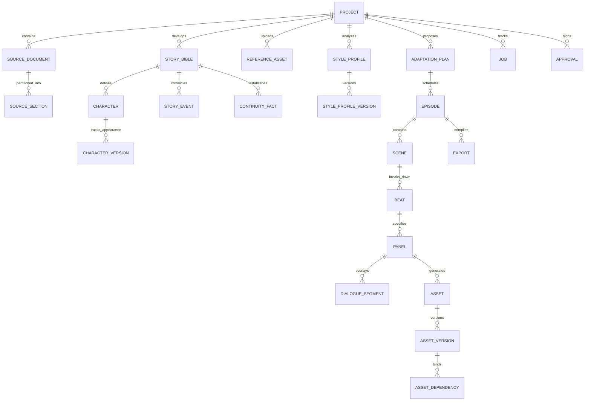

# Data Model and Versioning Guide

This document describes the complete relational data architecture and versioning rules implemented in the AI Novel-to-Webtoon Studio.

---

## 1. Entity-Relationship Overview

---

## 2. Table Definitions

### 2.1 Project & Source Ingestion
- **`projects`**:
  - `id`: UUID Primary Key
  - `title`, `description`: Text
  - `target_format`: Webtoon vertical specification (`webtoon_vertical`)
  - `current_stage`: Workflow progress tracker (`source_intake`, `story_analysis`, `style_analysis`, `adaptation_planning`, `storyboarding`, `illustration`, `final_review`, `completed`)
  - `status`: Active / Archived
  - `configuration`: JSONB project preferences (genre, pacing, target audience)
- **`source_documents`**:
  - `id`: UUID Primary Key, `project_id`: Foreign Key
  - `filename`, `storage_key`, `checksum`: SHA-256 integrity hash
  - `mime_type`, `char_count`, `word_count`, `extraction_status`
- **`source_sections`**:
  - `id`: UUID Primary Key, `document_id`: Foreign Key
  - `section_index`: Integer ordering
  - `title`, `content`: Section body
  - `start_char`, `end_char`: Source offset anchors for audit linking

### 2.2 Story & Canonical Characters
- **`story_bibles`**:
  - `id`: UUID Primary Key, `project_id`: Foreign Key, `version`: Integer
  - `premise`, `genre`, `target_audience`, `narrative_tone`
  - `world_rules`, `themes`, `uncertainties`: JSONB structured descriptive data
  - `status`: `draft`, `approved`, `deprecated`
- **`characters`**:
  - `id`: UUID Primary Key, `story_bible_id`: Foreign Key
  - `canonical_name`: Unique identity name
  - `aliases`: List of aliases/nicknames
  - `role`: `protagonist`, `antagonist`, `supporting`
  - `personality_summary`, `voice_and_mannerisms`: Text
- **`character_versions`**:
  - `id`: UUID Primary Key, `character_id`: Foreign Key, `version_number`: Integer
  - `physical_appearance`, `hair_style_and_color`, `clothing_and_accessories`
  - `distinctive_features`, `body_proportions`, `story_context`
  - `is_approved`: Boolean flag
- **`story_events`**:
  - `id`: UUID Primary Key, `story_bible_id`: Foreign Key
  - `chronological_order`: Integer
  - `title`, `summary`, `source_locator`, `emotional_weight`
- **`continuity_facts`**:
  - `id`: UUID Primary Key, `story_bible_id`: Foreign Key
  - `category`: `rule`, `timeline`, `lore`, `physical`
  - `statement`, `source_locator`, `is_confirmed`

### 2.3 Visual Style & References
- **`reference_assets`**:
  - `id`: UUID Primary Key, `project_id`: Foreign Key
  - `storage_key`, `filename`, `mime_type`, `file_size_bytes`, `width`, `height`
  - `role`: `visual_style`, `character_identity`, `layout_composition`, `environment`
  - `label`, `description`, `is_active`
- **`style_profiles` & `style_profile_versions`**:
  - `linework_and_contours`: Observed line weights and ink treatment
  - `anatomy_and_proportions`: Observed figure construction
  - `facial_features_and_expressions`: Eye, nose, expression construction
  - `palette_and_colors`: Array of hex color codes
  - `color_relationships`, `shading_and_lighting`, `texture_and_rendering`, `background_treatment`
  - `reference_isolation_notes`: Explicit notes certifying no narrative elements borrowed

### 2.4 Serialization & Storyboard
- **`adaptation_plans`**: Arcs, target episodes estimate, pacing strategy, story bible version binding.
- **`episodes`**: Episode premise, purpose, source sections covered, opening hook, ending cliffhanger, target panel count.
- **`scenes`**: Scene number, title, narrative purpose, environment, time of day, pacing.
- **`beats`**:
  - `dominant_emotion`, `secondary_emotion`: Explicit emotion breakdown
  - `emotional_intensity`: 1 to 10
  - `emotional_progression`: String trajectory (e.g. awkward -> irony -> tension)
  - `visual_exaggeration_constraint`: Grounded realism constraints
- **`panels`**:
  - `panel_number`: Strict sequential order
  - `shot_type`: `close_up`, `medium_shot`, `full_shot`, `wide_shot`, `extreme_close_up`
  - `camera_angle`: `eye_level`, `low_angle`, `high_angle`, `dutch_angle`
  - `composition_notes`, `focal_point`, `aspect_ratio` (4:5 standard)
  - `character_action`, `expression_and_body_language`, `environment_and_background`
  - `lighting_direction`, `local_emotion`, `vertical_spacing_after_px`
  - `version`, `is_approved`, `approved_by`
- **`dialogue_segments`**: Separate lettering layer (`speech_bubble`, `caption`, `sound_effect`, `thought_bubble`), position hints, order in panel.

### 2.5 Workflow, Assets & Approvals
- **`assets` & `asset_versions`**:
  - Storage keys, stage (`draft`, `final`, `edit`), model version, settings, prompt used, parent asset version ID.
  - Duration, actual cost, estimated cost, is_mock, is_approved.
- **`asset_dependencies`**:
  - Records dependencies (`panel_spec`, `style_profile`, `character_ref`).
  - Marks `is_stale` if upstream versions advance.
- **`approvals`**:
  - Immutable log of human creator approvals (`artifact_type`, `artifact_id`, `artifact_version`, `approved_by`, `comments`).
- **`exports`**:
  - Stored ZIP key, panel count, total height in px, slice count, verified status, manifest metadata.

---

## 3. Versioning Invariants & Rules

1. **Approved Artifacts are Immutable**: Once an artifact (Story Bible, Style Profile Version, Adaptation Plan, Storyboard Panel, Final Asset) is approved, it cannot be modified in-place. Edits create a new incremented version.
2. **Re-Review Trigger**: Modifying a storyboard panel automatically un-approves that panel and requires creator re-approval.
3. **Stale Overwrite Guard**: If an asynchronous generation job was queued for panel version $V_1$, but the panel was revised to version $V_2$ while the job was processing, the job runner blocks the stale asset from activating on the panel.
4. **Targeted Edit Lineage**: Applying targeted inpainting/corrections preserves the original asset version and creates a child version linked via `parent_asset_version_id`.
